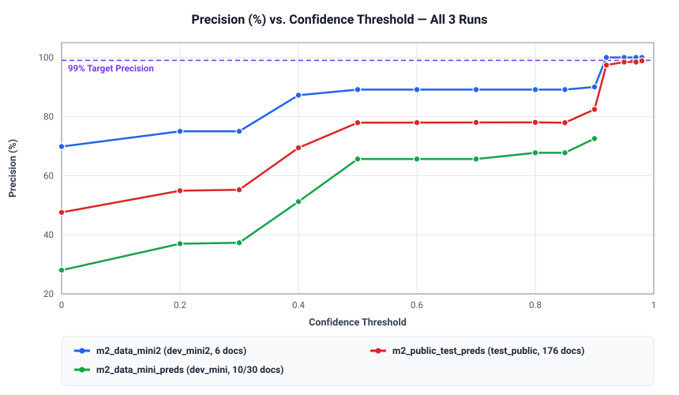
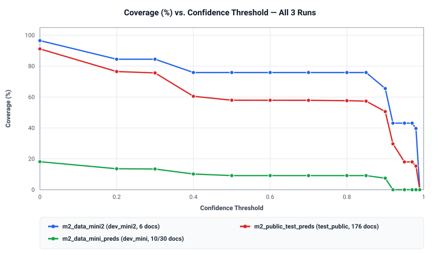
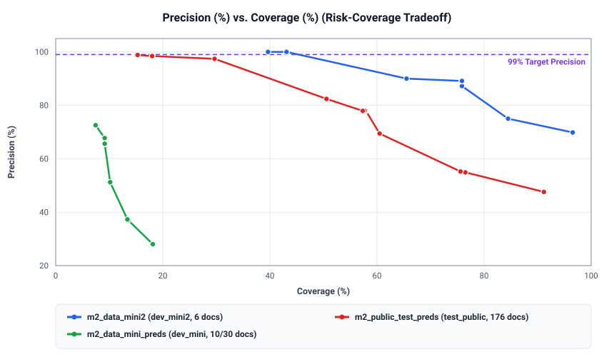
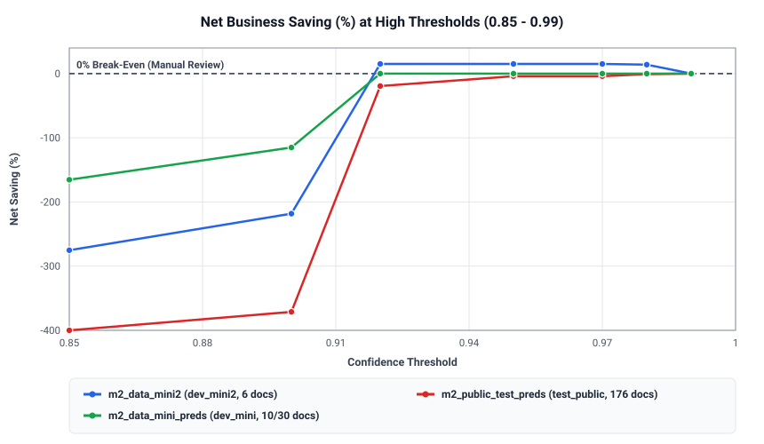

# Exploratory Data Analysis (EDA) — Existing Pipeline Runs

This document summarizes the empirical findings from running [5_score.py](file:///var/home/can/Documents/sixt-hackathon-2026/Project_1/5_score.py) across confidence thresholds on the three existing prediction runs in [runs/](file:///var/home/can/Documents/sixt-hackathon-2026/Project_1/runs), produced with the `m2_dual_consensus` strategy ([configs/m2_dual_consensus.json](file:///var/home/can/Documents/sixt-hackathon-2026/Project_1/configs/m2_dual_consensus.json)).

---

## 1. Runs & Dataset Overview

| Run File | Gold Dataset | Docs (Pred / Gold) | Sources (Gold) | Total Fields | Gold Present | Gold Null | Schema Validity |
| :--- | :--- | :---: | :--- | :---: | :---: | :---: | :---: |
| [m2_data_mini2.jsonl](file:///var/home/can/Documents/sixt-hackathon-2026/Project_1/runs/m2_data_mini2.jsonl) | [dev_mini2.jsonl](file:///var/home/can/Documents/sixt-hackathon-2026/Project_1/data/unified/dev_mini2.jsonl) | 6 / 6 | `cuad`: 3, `extractbench`: 3 | 165 | 58 (35.2%) | 107 (64.8%) | 66.67% |
| [m2_data_mini_preds.jsonl](file:///var/home/can/Documents/sixt-hackathon-2026/Project_1/runs/m2_data_mini_preds.jsonl) | [dev_mini.jsonl](file:///var/home/can/Documents/sixt-hackathon-2026/Project_1/data/unified/dev_mini.jsonl) | 10 / 30 | `cuad`: 15, `extractbench`: 15 | 1,172 | 590 (50.3%) | 582 (49.7%) | 80.00% |
| [m2_public_test_preds.jsonl](file:///var/home/can/Documents/sixt-hackathon-2026/Project_1/runs/m2_public_test_preds.jsonl) | [test_public.jsonl](file:///var/home/can/Documents/sixt-hackathon-2026/Project_1/data/unified/test_public.jsonl) | 176 / 176 | `cuad`: 129, `extractbench`: 47 | 6,962 | 2,865 (41.2%) | 4,097 (58.8%) | 90.91% |

> [!NOTE]
> Under the evaluation cost model (`review_cost = 1`, `error_cost = 100`), every accepted wrong or hallucinated value costs 100× a manual review. Therefore, automation only yields positive net savings when accepted predictions exceed **~99% precision**.

---

## 2. Precision, Coverage & Net Saving Across Confidence Thresholds

Each of the three runs is plotted with its own color and legend entry:
- **Blue:** `m2_data_mini2` (`dev_mini2`, 6 docs)
- **Red:** `m2_public_test_preds` (`test_public`, 176 docs)
- **Green:** `m2_data_mini_preds` (`dev_mini`, 10/30 docs predicted; 0 accepted above `0.90`)

### Precision vs. Confidence Threshold

### Coverage vs. Confidence Threshold

### Precision vs. Coverage (Risk–Coverage Tradeoff)

### Net Business Saving (%) at High Thresholds (`0.85` – `0.99`)

---

## 3. Detailed Threshold Sweep Tables

### Run 1: `m2_data_mini2.jsonl` on `dev_mini2.jsonl` (165 fields)

| Threshold | Accepted | Correct | Wrong | Hallucinated | Missed | Precision | Coverage | Recall | Net Saving % |
| :---: | :---: | :---: | :---: | :---: | :---: | :---: | :---: | :---: | :---: |
| **0.00** | 63 | 44 | 12 | 7 | 2 | 69.84% | 96.55% | 75.86% | -1113.33% |
| **0.30** | 56 | 42 | 7 | 7 | 9 | 75.00% | 84.48% | 72.41% | -814.55% |
| **0.40** | 47 | 41 | 3 | 3 | 14 | 87.23% | 75.86% | 70.69% | -335.15% |
| **0.50** | 46 | 41 | 3 | 2 | 14 | 89.13% | 75.86% | 70.69% | -275.15% |
| **0.85** | 46 | 41 | 3 | 2 | 14 | 89.13% | 75.86% | 70.69% | -275.15% |
| **0.90** | 40 | 36 | 2 | 2 | 20 | 90.00% | 65.52% | 62.07% | -218.18% |
| **0.92** | 25 | 25 | 0 | 0 | 33 | **100.00%** | 43.10% | 43.10% | **+15.15%** |
| **0.95** | 25 | 25 | 0 | 0 | 33 | **100.00%** | 43.10% | 43.10% | **+15.15%** |
| **0.97** | 25 | 25 | 0 | 0 | 33 | **100.00%** | 43.10% | 43.10% | **+15.15%** |
| **0.98** | 23 | 23 | 0 | 0 | 35 | **100.00%** | 39.66% | 39.66% | +13.94% |
| **0.99** | 0 | 0 | 0 | 0 | 58 | n/a | 0.00% | 0.00% | 0.00% |

### Run 2: `m2_public_test_preds.jsonl` on `test_public.jsonl` (6,962 fields)

| Threshold | Accepted | Correct | Wrong | Hallucinated | Missed | Precision | Coverage | Recall | Net Saving % |
| :---: | :---: | :---: | :---: | :---: | :---: | :---: | :---: | :---: | :---: |
| **0.00** | 3,322 | 1,581 | 1,031 | 710 | 253 | 47.59% | 91.17% | 55.18% | -2453.00% |
| **0.30** | 2,718 | 1,501 | 665 | 552 | 699 | 55.22% | 75.60% | 52.39% | -1709.02% |
| **0.40** | 2,014 | 1,398 | 335 | 281 | 1,132 | 69.41% | 60.49% | 48.80% | -855.87% |
| **0.50** | 1,775 | 1,383 | 277 | 115 | 1,205 | 77.92% | 57.94% | 48.27% | -537.56% |
| **0.80** | 1,766 | 1,378 | 274 | 114 | 1,213 | 78.03% | 57.66% | 48.10% | -531.94% |
| **0.90** | 1,557 | 1,283 | 166 | 108 | 1,416 | 82.40% | 50.58% | 44.78% | -371.20% |
| **0.92** | 853 | 831 | 19 | 3 | 2,015 | 97.42% | 29.67% | 29.01% | -19.35% |
| **0.95** | 517 | 509 | 7 | 1 | 2,349 | 98.45% | 18.01% | 17.77% | -4.06% |
| **0.97** | 517 | 509 | 7 | 1 | 2,349 | 98.45% | 18.01% | 17.77% | -4.06% |
| **0.98** | 439 | 434 | 4 | 1 | 2,427 | 98.86% | 15.29% | 15.15% | -0.88% |
| **0.99** | 0 | 0 | 0 | 0 | 2,865 | n/a | 0.00% | 0.00% | 0.00% |

### Run 3: `m2_data_mini_preds.jsonl` on `dev_mini.jsonl` (1,172 fields, 10 / 30 docs predicted)

| Threshold | Accepted | Correct | Wrong | Hallucinated | Missed | Precision | Coverage | Recall | Net Saving % |
| :---: | :---: | :---: | :---: | :---: | :---: | :---: | :---: | :---: | :---: |
| **0.00** | 157 | 44 | 63 | 50 | 483 | 28.03% | 18.14% | 7.46% | -950.77% |
| **0.30** | 118 | 44 | 35 | 39 | 511 | 37.29% | 13.39% | 7.46% | -621.33% |
| **0.40** | 82 | 42 | 18 | 22 | 530 | 51.22% | 10.17% | 7.12% | -334.30% |
| **0.50** | 64 | 42 | 12 | 10 | 536 | 65.62% | 9.15% | 7.12% | -182.25% |
| **0.70** | 64 | 42 | 12 | 10 | 536 | 65.62% | 9.15% | 7.12% | -182.25% |
| **0.80** | 62 | 42 | 12 | 8 | 536 | 67.74% | 9.15% | 7.12% | -165.36% |
| **0.85** | 62 | 42 | 12 | 8 | 536 | 67.74% | 9.15% | 7.12% | -165.36% |
| **0.90** | 51 | 37 | 7 | 7 | 546 | 72.55% | 7.46% | 6.27% | -115.10% |
| **0.92+** | 0 | 0 | 0 | 0 | 590 | n/a | 0.00% | 0.00% | 0.00% |

---

## 4. Breakdown by Source Dataset, Normalizer, and Capture Condition

### By Source Dataset

| Run | Source | Fields | `t=0.0` Prec | `t=0.0` Cov | `t=0.0` Wrong / Hall | `t=0.95` Acc | `t=0.95` Prec | `t=0.95` Cov | `t=0.95` Net Saving |
| :--- | :--- | :---: | :---: | :---: | :---: | :---: | :---: | :---: | :---: |
| `m2_data_mini2` | `cuad` | 123 | 46.15% | 90.48% | 7 / 7 | 0 | 100.00% | 0.00% | 0.00% |
| `m2_data_mini2` | `extractbench` | 42 | 86.49% | 100.00% | 5 / 0 | 25 | 100.00% | 67.57% | **+59.52%** |
| `m2_data_mini_preds` | `cuad` | 615 | 28.03% | 47.77% | 63 / 50 | 0 | 100.00% | 0.00% | 0.00% |
| `m2_data_mini_preds` | `extractbench` | 557 | 100.00% | 0.00% | 0 / 0 | 0 | 100.00% | 0.00% | 0.00% |
| `m2_public_test` | `cuad` | 5,289 | 26.45% | 87.38% | 905 / 680 | 0 | 100.00% | 0.00% | 0.00% |
| `m2_public_test` | `extractbench` | 1,673 | 86.63% | 96.60% | 126 / 30 | 517 | 98.45% | 43.84% | -16.92% |

### By Field Normalizer (`x-normalizer`)

| Run | Normalizer | Fields | `t=0.0` Prec | `t=0.0` Cov | `t=0.0` Wrong / Hall | `t=0.95` Acc | `t=0.95` Prec | `t=0.95` Cov |
| :--- | :--- | :---: | :---: | :---: | :---: | :---: | :---: | :---: |
| `m2_data_mini2` | `json` | 6 | 16.67% | 100.00% | 5 / 0 | 0 | 100.00% | 0.00% |
| `m2_data_mini2` | `span` | 123 | 46.15% | 90.48% | 7 / 7 | 0 | 100.00% | 0.00% |
| `m2_data_mini2` | `string` | 36 | 100.00% | 100.00% | 0 / 0 | 25 | 100.00% | 80.65% |
| `m2_data_mini_preds` | `json` | 33 | 100.00% | 0.00% | 0 / 0 | 0 | 100.00% | 0.00% |
| `m2_data_mini_preds` | `span` | 615 | 28.03% | 47.77% | 63 / 50 | 0 | 100.00% | 0.00% |
| `m2_data_mini_preds` | `string` | 524 | 100.00% | 0.00% | 0 / 0 | 0 | 100.00% | 0.00% |
| `m2_public_test` | `json` | 95 | 43.62% | 98.95% | 53 / 0 | 0 | 100.00% | 0.00% |
| `m2_public_test` | `span` | 5,289 | 26.45% | 87.38% | 905 / 680 | 0 | 100.00% | 0.00% |
| `m2_public_test` | `string` | 1,578 | 90.40% | 96.40% | 73 / 30 | 517 | 98.45% | 47.69% |

### By Capture Condition (`perception:*` on `extractbench`)

| Run | Condition | Fields | `t=0.0` Prec | `t=0.0` Cov | `t=0.95` Acc | `t=0.95` Prec | `t=0.95` Cov | `t=0.95` Wrong / Hall |
| :--- | :--- | :---: | :---: | :---: | :---: | :---: | :---: | :---: |
| `m2_data_mini2` | `perception:P2` | 18 | 82.35% | 100.00% | 12 | 100.00% | 70.59% | 0 / 0 |
| `m2_public_test` | `perception:P1` | 18 | 61.11% | 100.00% | 0 | 100.00% | 0.00% | 0 / 0 |
| `m2_public_test` | `perception:P2` | 1,050 | 86.84% | 96.41% | 238 | 96.64% | 34.00% | 7 / 1 |
| `m2_public_test` | `perception:P3` | 620 | 90.26% | 98.36% | 130 | 96.92% | 30.21% | 3 / 1 |

*(Note: in `test_public`, some `extractbench` fields carry multiple or overlapping tags, so condition counts reflect tag membership.)*

---

## 5. Key Findings & Error Analysis

1. **All high-confidence (`>= 0.95`) predictions come exclusively from `extractbench` (`string` fields).**
   - `cuad` (`span`) and `json` fields never reach `0.95` confidence in either run (0 accepted at `t=0.95`).
   - On `cuad` at `t=0.0`, raw precision is only **26.45%** on `test_public` (905 wrong, 680 hallucinated), so the confidence gate successfully suppresses `cuad` errors, but at the cost of 0% `cuad` automation.
2. **Why `test_public` missed the 99% precision target (8 errors at `conf >= 0.95`):**
   At `t=0.95`, 517 fields are accepted with 509 correct, **7 wrong**, and **1 hallucinated** (98.45% precision, -4.06% net saving):
   - **Formatting / normalization mismatches (3 errors):**
     - `p1_name_of_lease`: gold `'W.T. Waggoner Est "Z"'` vs pred `'W.T.Waggoner Est "Z"'` (missing space after `W.T.`, `conf=0.97`)
     - `telephone_area_code`: gold `'(940)'` vs pred `'940'` (parentheses stripped on a `string`-normalized field, `conf=0.98`)
     - `telephone_number`: gold `'592-4164'` vs pred `'592 - 4164'` (spaces around hyphen on a `string`-normalized field, `conf=0.98`)
   - **Partial value / unit omissions (3 errors):**
     - `h2s_concentration`: gold `'800 PPM'` vs pred `'800'` (`conf=0.98`)
     - `direction_from_nearest_town`: gold `'West of'` vs pred `'West'` (`conf=0.97`)
     - `deepest_freshwater_zone`: gold `'5300 USDW 4800 BUQW'` vs pred `'5300'` (`conf=0.97`)
   - **Genuine extraction error & hallucination (2 errors):**
     - `register_no_review`: gold `'55311'` vs pred `'6191535'` (`conf=0.98`)
     - `amount_review`: gold `null` vs pred `'250'` (`conf=0.98`, hallucinated)
3. **Dev-to-Test Calibration Gap:**
   - `dev_mini2` (6 docs) showed 100% precision and +15.15% net saving at `t=0.95`, which masked the ~1.55% tail error rate that appeared on the 176-doc `test_public` set.
   - Because `error_cost = 100`, even **5 errors** out of 439 accepted fields (`t=0.98`, 98.86% precision) results in `-0.88%` net saving. Reaching positive net saving on `test_public` requires eliminating at least 4 of those 8 high-confidence errors (e.g., stricter verbatim span/punctuation/unit checking in the verifier and tighter `null` gating on review fields).
4. **Partial Coverage in `m2_data_mini_preds.jsonl`:**
   - `m2_data_mini_preds.jsonl` contains predictions for only **10 of the 30** documents in `dev_mini.jsonl` (all from `cuad`, 0% coverage on `extractbench`).
   - Because `cuad` (`span`) fields peak at `conf = 0.90` (72.55% precision, 7.46% coverage), accepting anything at `t <= 0.90` yields negative net saving (-115.10% at `0.90`), and `t >= 0.92` defers 100% of fields to manual review (`0.0%` net saving).
