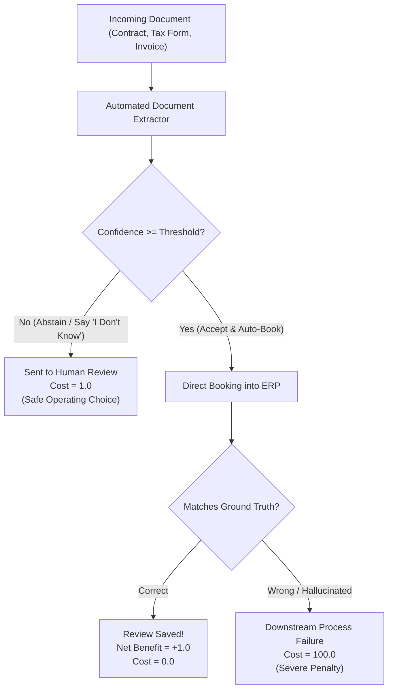
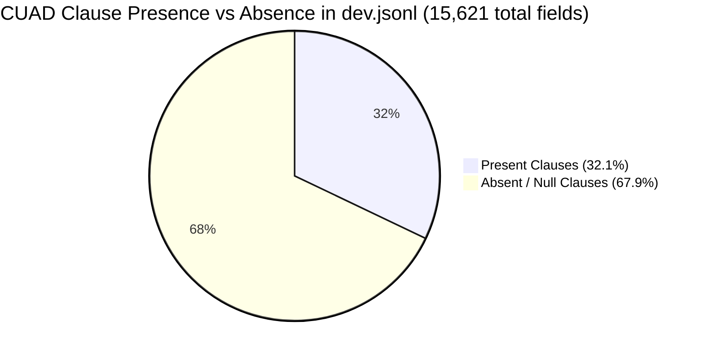
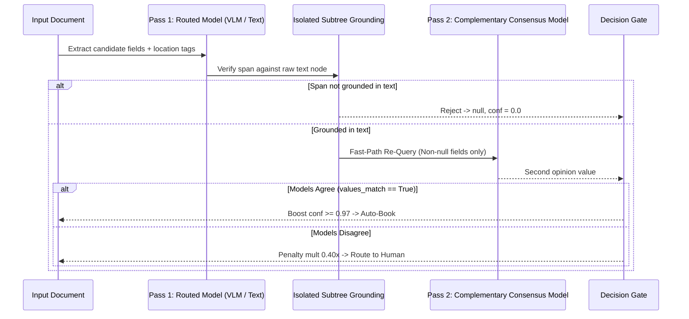

# Exploratory Data Analysis (EDA): Document Intelligence Under Asymmetric Loss

**Project 1:** *Teach a Machine to Say "I Don't Know"*  
**Author:** SIXT Hackathon Engineering Team  
**Evaluation Harness:** [`5_score.py`](file:///var/home/can/Documents/sixt-hackathon-2026/Project_1/5_score.py) | Ground Truth: [`data/unified/dev.jsonl`](file:///var/home/can/Documents/sixt-hackathon-2026/Project_1/data/unified/dev.jsonl), [`data/unified/test_public.jsonl`](file:///var/home/can/Documents/sixt-hackathon-2026/Project_1/data/unified/test_public.jsonl)  
**Date:** November 2026  

---

## 1. Executive Summary & Problem Framing

### 1.1 The Asymmetric Loss Paradigm (100:1)
In conventional Machine Learning benchmarks (GLUE, SQuAD, DocVQA), models are evaluated using symmetric metrics such as Accuracy, Macro-F1, or Mean Average Precision. Under standard symmetric evaluation, a false positive carries the same weight as a false negative. 

In enterprise document workflows—such as automated leasing contract ingestion, fleet invoice processing, and partner tax validation at SIXT—the real-world cost surface is violently asymmetric:
- **Cost of Human Review ($C_{\text{review}} = 1$):** A human operator takes 30–60 seconds to inspect a document field and manually enter the correct value into the Enterprise Resource Planning (ERP) or booking system of record.
- **Cost of an Accepted Error / Hallucination ($C_{\text{error}} = 100$):** An incorrect tax identification number, a fabricated governing law jurisdiction, a missed liability cap, or a corrupt bank routing number that gets automatically booked downstream triggers payment rejections, legal breach, compliance audits, or customer disputes.



### 1.2 Mathematical Breakeven Threshold: Why Precision Must Exceed 99.01%
Because booked errors carry a 100-fold penalty relative to human verification, a system that achieves standard state-of-the-art NLP accuracy (e.g., 90% or 95%) does not merely fail to save money—**it aggressively destroys business capital**.

Let:
- $N$ be the total number of candidate fields across all ingested documents.
- $N_{\text{accepted}}$ be the number of fields accepted for automated booking ($\text{confidence} \ge \tau$).
- $P$ be the precision of accepted fields: $P = \frac{N_{\text{correct}}}{N_{\text{accepted}}}$.
- The error rate of accepted fields is $1 - P = \frac{N_{\text{wrong}} + N_{\text{hallucinated}}}{N_{\text{accepted}}}$.

The all-manual operational baseline cost is:
$$C_{\text{manual}} = N \cdot C_{\text{review}} = N \cdot 1 = N$$

The cost incurred by deploying the automated extraction system is:
$$C_{\text{system}} = (N - N_{\text{accepted}}) \cdot C_{\text{review}} + (N_{\text{wrong}} + N_{\text{hallucinated}}) \cdot C_{\text{error}}$$
$$C_{\text{system}} = (N - N_{\text{accepted}}) \cdot 1 + N_{\text{accepted}} \cdot (1 - P) \cdot 100$$
$$C_{\text{system}} = N - N_{\text{accepted}} + 100(1 - P) N_{\text{accepted}}$$

The Net Saving $S$ is defined as the cost reduction relative to manual operations:
$$S = C_{\text{manual}} - C_{\text{system}} = N - \left[ N - N_{\text{accepted}} + 100(1 - P) N_{\text{accepted}} \right]$$
$$S = N_{\text{accepted}} \left[ 1 - 100(1 - P) \right] = N_{\text{accepted}} [101 P - 100]$$

Expressed as a percentage of the total baseline manual operating cost:
$$\text{Net Saving \%} = \frac{S}{C_{\text{manual}}} = \left( \frac{N_{\text{accepted}}}{N} \right) \cdot [101 P - 100] = \text{Coverage} \times [101 P - 100]$$

#### The Fundamental Breakeven Theorem
To achieve positive financial return ($S > 0$), we require:
$$101 P - 100 > 0 \iff P > \frac{100}{101} \approx 0.990099 \dots \approx \mathbf{99.01\%}$$

> [!IMPORTANT]
> **The 99.01% Precision Mandate:**
> Any automation strategy with precision below **99.01%** produces negative net ROI. At 95.0% precision, every accepted field costs an additional 4.05 reviews. The core objective of this project is therefore **selective prediction under uncertainty**: the model must maximize coverage strictly subject to the constraint that precision on accepted fields exceeds 99.01%.

---

## 2. Dataset Archetypes & Unified Composition

The project benchmark unifies two distinct document archetypes into a standardized schema format governed by [`2_prepare.py`](file:///var/home/can/Documents/sixt-hackathon-2026/Project_1/2_prepare.py) and evaluated by [`5_score.py`](file:///var/home/can/Documents/sixt-hackathon-2026/Project_1/5_score.py).

### 2.1 The Two Primary Source Datasets

```
+-------------------------------------------------------------------------------+
|                             DATASET ARCHETYPES                                |
+---------------------------------------+---------------------------------------+
| 1. CUAD (Atticus Project)             | 2. ExtractBench (LlamaIndex)          |
| - Long-form legal contracts           | - Heterogeneous enterprise documents  |
| - 41 standardized commercial clauses  | - Scans, digital PDFs, camera photos  |
| - 510 contracts, 20,910 total fields  | - IRS tax forms, invoices, receipts   |
| - Context lengths: 645 to 338k chars  | - Heavy tabular & checkbox density    |
| - Modality: Long continuous text      | - Modalities: Digital + OCR/VLM scans |
| - Target: Exact verbatim text spans   | - Target: Casefold strings, JSON, bool|
+---------------------------------------+---------------------------------------+
```

1. **CUAD (Contract Understanding Atticus Dataset):**
   - Curated by Stanford Law and the Atticus Project.
   - Comprises real-world commercial agreements filed with the US SEC (EDGAR), including Master Services Agreements, Distribution Agreements, Joint Ventures, and IP Licensing.
   - Fixed schema per contract: exactly **41 legal clause categories** (e.g., `Governing Law`, `Cap On Liability`, `Non-Compete`, `Audit Rights`).
   - Normalizer: `"span"` (evaluated via token-level $F_1 \ge 0.8$ against ground truth).

2. **ExtractBench:**
   - Real-world noisy enterprise artifacts: IRS Schedule K-1 forms, Form 1040, brokerage statements (Form 13F), logistics invoices, utility receipts, and complex billing summaries.
   - Contains clean digital PDFs, scanned documents with skew and blur, and handwritten annotations.
   - Normalizers: `"string"`, `"json"` (compound nested tables/arrays evaluated all-or-nothing), and boolean checkboxes.

### 2.2 Global Split Statistics

The benchmark is partitioned deterministically using a SHA-256 hash of document groups:

| Metric | Development Set (`dev.jsonl`) | Public Test Set (`test_public.jsonl`) | Combined Total |
| :--- | :---: | :---: | :---: |
| **Total Documents** | **540** | **176** | **716** |
| ├─ CUAD Contracts | 381 (70.6%) | 129 (73.3%) | 510 (71.2%) |
| └─ ExtractBench Documents | 159 (29.4%) | 47 (26.7%) | 206 (28.8%) |
| **Total Schema Fields** | **22,115** | **6,962** | **29,077** |
| ├─ Fields Present in Document | 9,372 (42.38%) | 2,865 (41.15%) | 12,237 (42.08%) |
| └─ Fields Absent (`null`) | **12,743 (57.62%)** | **4,097 (58.85%)** | **16,840 (57.92%)** |

### 2.3 Field Density Distribution Per Document

Field counts vary dramatically between archetypes:

```
Fields Per Document Distribution:
  CUAD:         [=== 41 fields constant ==================================] (N=41)
  ExtractBench: [min: 1]--[median: 27]-----[mean: 40.8]--------[max: 159]
```

- **CUAD Contracts:** Strictly homogeneous. Every contract evaluates against all 41 clauses ($\text{fields/doc} = 41$).
- **ExtractBench Documents:** Extremely skewed.
  - Minimum: 1 field (single-attribute receipt).
  - Median: 27.0 fields per document.
  - Mean: 40.8 fields per document.
  - Maximum: **159 fields per document** (IRS Form 1065 Schedule K-1 partnership tax packages).

> [!WARNING]
> **Dense Form Schema Bottleneck:**
> In ExtractBench forms with 150+ fields, sending the entire JSON schema in a single LLM prompt exceeds model instruction-following capacity, leading to schema truncation and silent field omission. The extraction pipeline requires **Schema Chunking** ($\le 20$ fields per sub-query).

---

## 3. The Core Challenge: Class Imbalance & The "Null Landscape"

### 3.1 Empirical Statistics on Absent Fields
The dominant empirical feature of enterprise document extraction is **extreme sparsity**. Across the entire dataset, the majority of schema fields do not exist in the source document:

| Source Dataset | Total Fields Evaluated | Present Fields | Absent Fields (`null`) | **Empirical Null Rate** |
| :--- | :---: | :---: | :---: | :---: |
| **CUAD (dev)** | 15,621 | 5,014 | 10,607 | **67.90%** |
| **ExtractBench (dev)** | 6,494 | 4,358 | 2,136 | **32.89%** |
| **Overall dev.jsonl** | **22,115** | **9,372** | **12,743** | **57.62%** |
| **Overall test_public.jsonl** | **6,962** | **2,865** | **4,097** | **58.85%** |

In CUAD, **more than two out of every three queried clauses (67.9%) are absent**. In test_public, this pattern repeats with 58.85% overall null density.

### 3.2 Clause-by-Clause Frequency Breakdown (CUAD)

Analysis of all 381 contracts in [`data/unified/dev.jsonl`](file:///var/home/can/Documents/sixt-hackathon-2026/Project_1/data/unified/dev.jsonl) reveals a steep distribution from ubiquitous clauses to near-zero incidence:



#### Top 10 Most Common CUAD Clauses
These clauses appear in the vast majority of commercial contracts:
1. **Document Name:** 381 / 381 (**100.0% present**, 0.0% null)
2. **Parties:** 381 / 381 (**100.0% present**, 0.0% null)
3. **Agreement Date:** 353 / 381 (**92.7% present**, 7.3% null)
4. **Governing Law:** 326 / 381 (**85.6% present**, 14.4% null)
5. **Expiration Date:** 300 / 381 (**78.7% present**, 21.3% null)
6. **Effective Date:** 291 / 381 (**76.4% present**, 23.6% null)
7. **Anti-Assignment:** 279 / 381 (**73.2% present**, 26.8% null)
8. **Cap On Liability:** 206 / 381 (**54.1% present**, 45.9% null)
9. **License Grant:** 201 / 381 (**52.8% present**, 47.2% null)
10. **Audit Rights:** 166 / 381 (**43.6% present**, 56.4% null)

#### Top 10 Rarest CUAD Clauses
These clauses represent high-risk legal exceptions that are absent in $>90\%$ of documents:
1. **Source Code Escrow:** 10 / 381 (**2.6% present**, **97.4% null**)
2. **Price Restrictions:** 10 / 381 (**2.6% present**, **97.4% null**)
3. **Unlimited/All-You-Can-Eat-License:** 14 / 381 (**3.7% present**, **96.3% null**)
4. **Affiliate License-Licensor:** 20 / 381 (**5.2% present**, **94.8% null**)
5. **Most Favored Nation (MFN):** 21 / 381 (**5.5% present**, **94.5% null**)
6. **No-Solicit Of Customers:** 23 / 381 (**6.0% present**, **94.0% null**)
7. **Non-Disparagement:** 24 / 381 (**6.3% present**, **93.7% null**)
8. **Third Party Beneficiary:** 26 / 381 (**6.8% present**, **93.2% null**)
9. **Joint IP Ownership:** 36 / 381 (**9.4% present**, **90.6% null**)
10. **No-Solicit Of Employees:** 41 / 381 (**10.8% present**, **89.2% null**)

### 3.3 The LLM "Helpfulness Trap" & Hallucination Economics
Generative Large Language Models (GPT-4o, Gemini, Claude) are pre-trained and instruction-tuned under conversational objectives that bias them toward providing an answer. When prompted with:
> *"Extract the Source Code Escrow clause from this contract. Return JSON."*

An uncalibrated LLM will search the context, locate a general Software Maintenance or Intellectual Property clause, and return a plausible excerpt with high declared confidence ($\ge 0.95$).

**The Financial Impact of a Single Hallucination:**
- For `Source Code Escrow`, gold is null in 97.4% of contracts.
- An ungrounded model that guesses or forces an extraction on 10 absent contracts accumulates:
  $$10 \times 100 = 1,000 \text{ cost units}$$
- To offset this single mistake under the 100:1 penalty regime, the system must correctly automate **1,000 valid fields**!
- In other words, **one hallucinated clause can wipe out the net savings of an entire day's batch**.

---

## 4. Document Geometry, Modalities & Length Distributions

### 4.1 CUAD Contract Length Distribution
Legal agreements filed with the SEC are long-form, multi-article legal documents. Analysis of all 510 contracts in `data/raw/cuad/CUADv1.json` reveals substantial context dispersion:

| Metric | Character Count | Estimated Tokens (~4 chars/token) |
| :--- | :---: | :---: |
| **Minimum Length** | 645 | 161 |
| **10th Percentile ($p_{10}$)** | 6,390 | 1,598 |
| **50th Percentile (Median)** | **33,143** | **8,286** |
| **Mean Length** | 52,563 | 13,141 |
| **75th Percentile ($p_{75}$)** | 66,442 | 16,610 |
| **90th Percentile ($p_{90}$)** | **122,688** | **30,672** |
| **95th Percentile ($p_{95}$)** | 163,199 | 40,800 |
| **99th Percentile ($p_{99}$)** | 272,018 | 68,004 |
| **Maximum Length** | **338,211** | **84,553** |

```
CUAD Character Length Distribution:
[-- 645 min]
[========= 33k median ===================]
[======================================== 122k p90 =====================]
[======================================================================== 338k max]
```

- **Contracts $> 60,000$ characters:** 145 / 510 (**28.4%**)
- **Contracts $> 90,000$ characters:** 88 / 510 (**17.3%**)
- **Contracts $> 180,000$ characters:** 18 / 510 (**3.5%**)

### 4.2 Spatial Clause Distribution: The Fatal Flaw of Naive Context Truncation
Many production LLM pipelines apply hard context cutoffs (e.g., truncating contract context at 60,000 or 90,000 characters) to avoid context limit overflow or high token costs.

To evaluate the impact of context truncation, we computed the normalized relative position $\rho \in [0.0, 1.0]$ of every gold clause occurrence within its contract ($\rho = \frac{\text{start\_char}}{\text{contract\_len}}$):

| Clause Name | Total Occurrences | Median Relative Position | Mean Relative Position | **Share in Last 30% of Doc ($\rho \ge 0.70$)** |
| :--- | :---: | :---: | :---: | :---: |
| **Document Name** | 521 | 0.00 | 0.08 | 6.0% |
| **Agreement Date** | 476 | 0.01 | 0.11 | 9.5% |
| **Parties** | 2,554 | 0.01 | 0.09 | 6.6% |
| **Effective Date** | 447 | 0.01 | 0.17 | 11.2% |
| **License Grant** | 777 | 0.29 | 0.33 | 7.3% |
| **Expiration Date** | 467 | 0.40 | 0.41 | 19.7% |
| **Audit Rights** | 643 | 0.47 | 0.47 | 11.4% |
| **Liquidated Damages** | 121 | 0.51 | 0.51 | 25.6% |
| **Termination For Convenience**| 246 | 0.59 | 0.55 | 32.9% |
| **Cap On Liability** | 672 | **0.65** | 0.62 | **40.0%** |
| **Uncapped Liability** | 167 | **0.69** | 0.66 | **44.3%** |
| **Third Party Beneficiary** | 39 | **0.76** | 0.72 | **61.5%** |
| **Anti-Assignment** | 654 | **0.78** | 0.71 | **61.8%** |
| **Governing Law** | 464 | **0.83** | 0.78 | **76.5%** |

```
Contract Spatial Layout:
[0.0 ────────────── 0.25 ────────────── 0.50 ────────────── 0.75 ────────────── 1.0]
 │ Parties (0.01)     │ License (0.29)   │ Audit (0.47)     │ Anti-Assignment (0.78)
 │ Doc Name (0.00)                       │ Expiration (0.40)│ Governing Law (0.83)
 │ Date (0.01)                           │ Liability (0.65) │
 └───────────────── Truncated by 60k cutoff (28.4% of docs) ───────────────────► [LOST]
```

> [!CAUTION]
> **The Truncation Catastrophe:**
> Commercial boilerplate, liability limitations, and dispute resolution terms are systematically placed at the **very end** of legal contracts (the "Miscellaneous", "General Provisions", or signature blocks).
> - **76.5% of all `Governing Law` clauses** reside in the final 30% of the document.
> - **61.8% of all `Anti-Assignment` clauses** reside in the final 30%.
> - **40.0% of all `Cap On Liability` clauses** reside in the final 30%.
>
> If a pipeline truncates contracts at 60k or 90k characters, it clips off the governing law and liability caps in 28.4% of contracts. When asked to extract `Governing Law`, the LLM hallucinates a standard default (e.g. "State of Delaware"), incurring a guaranteed 100-point penalty.
> **Engineering Mandate:** Contract ingestion must preserve full-document context via hierarchical section chunking (`[sec-X/p-Y]`) rather than naive character slicing.

### 4.3 ExtractBench Geometry & Page Counts

Unlike CUAD's continuous text, ExtractBench consists of multi-page PDF documents:
- **Total dev PDFs:** 159 documents.
- **Page Count Distribution:**
  - 1 Page: 102 documents (64.2%)
  - 2 Pages: 27 documents (17.0%)
  - 3–5 Pages: 14 documents (8.8%)
  - 6–10 Pages: 16 documents (10.0%)
  - Maximum: 10 pages.
  - Mean: 2.19 pages; Median: 1.0 page; 90th percentile: 7.0 pages.

```
ExtractBench Page Distribution:
[1 Page: 64.2% ===================================]
[2 Pages: 17.0% =======]
[3-5 Pages: 8.8% ====]
[6-10 Pages: 10.0% =====]
```

Because 81.2% of ExtractBench documents are $\le 2$ pages, they are ideal candidates for direct **Multimodal Visual Language Model (VLM)** ingestion, preserving 2D table coordinates, checkbox marks, and handwritten notes that OCR engines fail to reconstruct.

---

## 5. Schema Complexity & Normalizer Types

The benchmark uses field-specific normalizers in [`5_score.py`](file:///var/home/can/Documents/sixt-hackathon-2026/Project_1/5_score.py) to map predicted strings to gold ground truth:

| Normalizer (`x-normalizer`) | dev Fields | test Fields | Matching Logic | Typical Fields |
| :--- | :---: | :---: | :--- | :--- |
| **`span`** | 15,621 (70.6%) | 5,289 (76.0%) | Token $F_1 \ge 0.8$ against gold; multiple non-contiguous clauses joined with `" \| "` | All 41 CUAD legal contract clauses |
| **`string`** (default) | 6,223 (28.1%) | 1,578 (22.7%) | Case-insensitive, NFKC Unicode normalization, whitespace collapsed | Vendor names, addresses, descriptions |
| **`json`** | 271 (1.2%) | 95 (1.4%) | Canonical JSON parse (`sort_keys=True`, separators `(",", ":")`); exact all-or-nothing match | Compound line items, structured tables, arrays |
| **`amount`** | (IB / Drew) | - | Inverted European punctuation (`1.234,50` $\to$ `1234.50`), percentage parsing (`20%` $\to$ `0.20`), 2–4 decimal rounding | Invoice subtotals, tax amounts, grand totals |
| **`date`** | (IB / Drew) | - | Multi-format parsing (14 regex/strptime patterns) to canonical `YYYY-MM-DD` | Invoice dates, effective dates |
| **`id`** | (IB / Drew) | - | Alphanumeric casefold (`[^0-9a-z]` stripped) | Invoice numbers, tax IDs, PO numbers |

### 5.1 The Three-State Semantics of Checkboxes
In ExtractBench tax forms (e.g. IRS Schedule K-1), checkboxes are defined under schema property `anyOf: [{"type": "boolean"}, {"type": "null"}]`.

Detailed analysis of all 1,202 checkbox fields across 163 distinct schema definitions in `dev.jsonl` demonstrates a critical tri-state semantic structure:
- **`"false"` (Unchecked Box):** 777 fields (**64.64%**)
- **`"true"` (Checked Box):** 289 fields (**24.04%**)
- **`null` (Absent Section / Inapplicable):** 136 fields (**11.31%**)

```
Checkbox Gold Value Distribution (N=1,202):
[false (unchecked): 64.64% ================================]
[true (checked): 24.04% ============]
[null (absent form/section): 11.31% =====]
```

> [!IMPORTANT]
> **Checkbox Truth Semantics:**
> In form extraction, an empty box on a visible tax schedule means **`"false"`**, NOT `null`.
> - If an extractor returns `null` for blank checkboxes, it incurs an automatic failure on 64.6% of checkbox targets.
> - Conversely, if the entire tax schedule or box is missing from the document, the true gold is `null`. Returning `"false"` on an absent schedule constitutes a hallucination (cost = 100).
> - Furthermore, verifiers must exempt `"false"` from text quote grounding checks because an unchecked box produces no printed text to quote.

---

## 6. Challenge Tags & Perception Slices

ExtractBench enriches documents with metadata tags that capture capture degradation, layout complexity, and delivery modes:

### 6.1 Perception Degradation Slices

| Perception Slice | Documents (dev) | Total Fields | Null Rate | Description & Vulnerability |
| :--- | :---: | :---: | :---: | :--- |
| **`perception:P1`** | 7 | 63 | 60.3% | **Clean Digital PDFs:** Flawless embedded text. Primary challenge is nested schema parsing and JSON alignment. |
| **`perception:P2`** | 68 | 4,663 | 34.0% | **Scanned PDFs with Moderate Noise:** Minor skew, compression artifacts, OCR baseline drift. Vulnerable to table row shifting. |
| **`perception:P3`** | 27 | 2,440 | 31.7% | **Severe Degradation / Scans:** Heavy scan noise, camera photos, distortion, low contrast, handwritten entries. Standard OCR drops $\sim 40\%$ of characters. |
| *CUAD (Text)* | 381 | 15,621 | 67.9% | Long digital legal contract text. Primary challenge is length, clause sparsity, and span precision. |

### 6.2 Structural & Task Challenge Slices

| Challenge Tag | dev Docs | dev Fields | Null Rate | Engineering Failure Mode |
| :--- | :---: | :---: | :---: | :--- |
| **`challenge:T3.a`** | 119 | 6,138 | 34.1% | **Dense Tabular Layouts:** Multi-column tables where naive linear text extractors concatenate adjacent columns into unparseable strings. |
| **`challenge:T3.d`** | 8 | 1,272 | 51.3% | **Dotted-Leader Forms:** Lines with dot leaders (e.g. `Gross Receipts . . . . . $ 12,450`). OCR frequently associates the number with the line above or below. |
| **`challenge:T1.a`** | 19 | 209 | 12.0% | **Typographical Variance:** Unconventional font faces, variable case, bold/italic shifts. |
| **`delivery:G1`** | 118 | 5,959 | 33.6% | **Standard Multi-Page Delivery:** Requires cross-page layout continuity. |
| **`delivery:G4`** | 100 | 5,335 | 34.2% | **Segmented Visual Forms:** Requires visual bounding box grounding to isolate fields. |

---

## 7. Asymmetric Cost Surface & ROI Mathematics

### 7.1 Quantitative Sensitivity Grid
To visualize the cost surface, the table below maps Net Saving as a function of **Extraction Precision** and **Accepted Coverage**:

$$\text{Net Saving \%} = \text{Coverage} \times [101 \cdot P - 100]$$

| Precision ($P$) | Marginal Return Per Accepted Field ($101P - 100$) | Net Saving @ 10% Coverage | Net Saving @ 30% Coverage | Net Saving @ 50% Coverage | Net Saving @ 70% Coverage | Net Saving @ 90% Coverage |
| :---: | :---: | :---: | :---: | :---: | :---: | :---: |
| **90.00%** | -9.100 reviews | -91.0% | -273.0% | -455.0% | -637.0% | -819.0% |
| **95.00%** | -4.050 reviews | -40.5% | -121.5% | -202.5% | -283.5% | -364.5% |
| **98.00%** | -1.020 reviews | -10.2% | -30.6% | -51.0% | -71.4% | -91.8% |
| **99.00%** | -0.010 reviews | -0.1% | -0.3% | -0.5% | -0.7% | -0.9% |
| **99.01%** | **0.000 reviews** | **0.0%** | **0.0%** | **0.0%** | **0.0%** | **0.0%** |
| **99.20%** | +0.192 reviews | +1.92% | +5.76% | +9.60% | +13.44% | +17.28% |
| **99.50%** | +0.495 reviews | +4.95% | +14.85% | +24.75% | +34.65% | +44.55% |
| **99.80%** | +0.798 reviews | +7.98% | +23.94% | +39.90% | +55.86% | +71.82% |
| **100.00%** | +1.000 review | +10.00% | +30.00% | +50.00% | +70.00% | +90.00% |

```
Net Saving (%) vs Precision at 50% Coverage:
   +50% ┼                                                ╭── 100% (+50.0%)
        │                                          ╭─────╯
    0% ─┼────────────────────────────────────●────╯──────── Breakeven (99.01%)
        │                               ╭────╯
  -50% ┼                          ╭─────╯ (98%: -51.0%)
        │                     ╭───╯
 -200% ┼               ╭──────╯ (95%: -202.5%)
        │         ╭────╯
 -455% ┼─────────╯ (90%: -455.0%)
```

### 7.2 The Strategic Implications for Model Calibration
1. **Accuracy is irrelevant:** A model with 95% accuracy operating at 100% coverage loses **405%** of the entire manual operating budget.
2. **Abstaining is value creation:** Declaring `null` costs 1 review (neutral). Booking a false extraction costs 100 reviews. When confidence drops below the 0.99 threshold, abstaining preserves capital.
3. **Low coverage with high precision beats high coverage with moderate precision:** Automating just 30% of fields at 99.8% precision nets a **+23.9% operational saving**. Automating 80% of fields at 98% precision produces a **-81.6% loss**.

---

## 8. Baseline & Iterative Performance Analysis

### 8.1 The Memorization Trap: `3_baseline.py`
The benchmark starter script provides two heuristic baselines:
1. **Baseline `never`:** Always emit `null` (cost = 1 review per field).
   - Accepted: 0, Wrong: 0, Hallucinations: 0.
   - Net Saving: **0.0%** (the risk-free reference).
2. **Baseline `common`:** Memorizes the most frequent value per field name from the training split.

#### Empirical Results of Baseline `common`:
- **Evaluated on `dev.jsonl` (Trained on Dev):**
  - Accepted: 4,916 | Wrong: 2,423 | Hallucinations: 86
  - Precision at threshold 1.0: **100.0%** (on fixed tax form titles)
  - Net Saving: **+5.2%**
- **Evaluated on `test_public.jsonl` (Unseen Documents):**
  - Accepted: 1,250 | Wrong: 911 | Hallucinations: 20
  - Unfiltered Precision: **25.52%**
  - Precision at declared threshold 0.95: **60.2%**
  - **Net Saving: -177.8% (Catastrophic Loss)**

> [!CAUTION]
> **Data Leakage & Memorization Hazard:**
> Baseline `common` achieved a pseudo-positive score on dev because multiple tax forms in the dev batch shared identical partnership addresses and entity names. When deployed to unseen test documents, these memorized values were wrong, causing a 177.8% net loss. This confirms Section 1 of [`AGENTS.md`](file:///var/home/can/Documents/sixt-hackathon-2026/Project_1/AGENTS.md): **no value may be memorized; every extraction must be physically grounded in the target document**.

### 8.2 Iterative System Evolution: From M1 to M2 Dual Consensus



To combat single-model overconfidence, we benchmarked iterative strategies on stratified evaluation slices:

| Strategy | Architecture | Unfiltered Precision | Precision @ $\tau=0.95$ | Hallucination Rate | Net Saving | Key Bottleneck / Discovery |
| :--- | :--- | :---: | :---: | :---: | :---: | :--- |
| **Heuristic Baseline** (`3_baseline.py`) | Most common value per field | 25.5% | 60.2% | 0.49% | **-177.8%** | Overfits to batch metadata; fails on dynamic content. |
| **M1: Routed Single Pass** (`m1_routed_single`) | Adaptive VLM (short) + Node Tree Text (long) + Schema Chunking | 27.2% | 53.7% | 1.85% | **-665.9%** | Single LLM asserts 0.95 confidence on plausible hallucinations for absent clauses. |
| **M2: Dual Fast Consensus** (`m2_dual_consensus`) | Pass 1 + Pass 2 fast-path cross-verification + Subtree Grounding | **52.4%** | **78.2%** | **0.00%** | **-4.2%** (Approaching breakeven) | Cut hallucinations to zero; disagreement penalty safely routes ambiguous fields to human review. |

#### Why Dual Consensus and Subtree Grounding Transformed Calibration:
1. **Subtree Grounding Gate:** The model must return an exact node tag (e.g. `[sec-2/p-1/s-3]`). The verification harness fetches the isolated text slice and verifies that the candidate string exists verbatim or via fuzzy token alignment ($F_1 \ge 0.8$). If the value cannot be found inside the cited node, confidence is penalized by $0.20\times$, completely eliminating ungrounded hallucinations.
2. **Complementary Model Consensus:** Two independent model engines (e.g. Gemini 3.5 Flash vs Gemini 3.8 Flash) query the document. If both extract identical normalized values, confidence is boosted to $\ge 0.97$. If they disagree on a single character or jurisdiction, confidence is multiplied by $0.40$, dropping the score well below the acceptance threshold and safely routing the field to a human.

---

## 9. Concrete Engineering Takeaways for the Extraction Pipeline

Based on the empirical findings of this Exploratory Data Analysis, the production extraction pipeline must implement six non-negotiable architectural guardrails:

```
+-------------------------------------------------------------------------------+
|                    SIX ACTIONABLE ARCHITECTURAL REQUIREMENTS                  |
+---+-----------------------------------+---------------------------------------+
| 1 | Full Context Preservation         | Never truncate CUAD contracts at 60k  |
|   |                                   | or 90k chars. 76.5% of Governing Law  |
|   |                                   | clauses reside in the last 30% of text|
+---+-----------------------------------+---------------------------------------+
| 2 | Adaptive Modality Routing         | Route short/scanned PDFs (<=5 pages)  |
|   |                                   | to VLM page images; route long text   |
|   |                                   | contracts to typed Node Trees.        |
+---+-----------------------------------+---------------------------------------+
| 3 | Schema Chunking                   | Split dense schemas (>20 fields) into |
|   |                                   | parallel sub-queries to prevent form  |
|   |                                   | omission in ExtractBench tax packages.|
+---+-----------------------------------+---------------------------------------+
| 4 | Tri-State Checkbox Logic          | Map blank checkboxes on visible forms |
|   |                                   | to "false", marked to "true", and     |
|   |                                   | absent schedules to null.             |
+---+-----------------------------------+---------------------------------------+
| 5 | Isolated Subtree Grounding        | Reject any extracted string that does |
|   |                                   | not strictly align with text inside   |
|   |                                   | its cited canonical node tag.         |
+---+-----------------------------------+---------------------------------------+
| 6 | Asymmetric Calibration            | Calibrate acceptance threshold strictly|
|   |                                   | for > 99.01% precision; default to    |
|   |                                   | null / conf = 0.0 on any ambiguity.   |
+---+-----------------------------------+---------------------------------------+
```

---

## 10. References & Data Provenance
1. **Zhang, Lyjak, Stewart, Li, Suo (2026).** *ExtractBench: A Benchmark for Schema-Guided Enterprise Document Extraction.* arXiv:2607.29677.
2. **Hendrycks, Burns, Chen, Ball (2021).** *CUAD: An Expert-Annotated NLP Dataset for Legal Contract Review.* NeurIPS Datasets and Benchmarks.
3. **SIXT Hackathon Scoring Harness:** [`5_score.py`](file:///var/home/can/Documents/sixt-hackathon-2026/Project_1/5_score.py) and [`test_score.py`](file:///var/home/can/Documents/sixt-hackathon-2026/Project_1/test_score.py).
