# Teach a Machine to Say "I Don't Know"
### High-Precision Document Extraction Under 100:1 Asymmetric Cost

**SIXT Hackathon 2026 — Project 1**  
**Engineering Architecture & Technical Solution**

<div class="callout">

**The Core Rule:** A human review costs **1**. A wrong booked value costs **100**.  
To save money, automated decisions must exceed **99.01% precision**.  
*Abstaining ("I don't know") is not a failure—it is the safest, most profitable action.*

</div>

<!-- Speaker Notes:
Welcome everyone. Today we are presenting Project 1: Teaching a machine to say 'I don't know'.
In real enterprise workflows at SIXT—contracts, vehicle handovers, invoices—a wrong value reaching the system of record carries catastrophic costs: re-invoicing, compliance breaches, partner disputes.
Our entire architecture is built around this reality: achieving mathematically verified precision above 99% through layout-aware parsing, adaptive routing, and dual-model consensus.
-->

---

## 1. End-to-End System Architecture

```mermaid
flowchart LR
    Doc["Raw Document\n(PDF, Scan, CUAD)"] --> Parser["Layout-Aware Parser\n(Canonical Node Tree)"]
    Parser --> Router{"Adaptive Router\n(router.py)"}
    
    Router -->|"Scans / Short Forms\n(<= 5 pages)"| VLM["VLM Engine\n(High-DPI Images)"]
    Router -->|"Long Legal Contracts\n(CUAD > 5 pages)"| Text["Text Engine\n(Tagged Node Tree)"]
    
    VLM --> SchemaChunk["Schema Chunking\n(<= 20 fields/query)"]
    Text --> SchemaChunk
    
    SchemaChunk --> Extractor["Async Extractor\n(Location-Only Span)"]
    Extractor --> Consensus{"Dual Consensus\n(Fast-Path Pass 2)"}
    
    Consensus -- "Disagree" --> Abstain["Route to Human\n(Conf = 0.0, Cost = 1)"]
    Consensus -- "Agree" --> Verifier["Grounding Verifier\n(Subtree + Regex + Math)"]
    
    Verifier --> Decision{"Conf >= 0.95?"}
    Decision -- "Yes" --> Booked["Auto-Booked to ERP\n(Saved Review)"]
    Decision -- "No" --> Abstain
```



<!-- Speaker Notes:
Here is our high-level architecture. Notice four foundational pillars:
1. We parse documents into a Hierarchical Node Tree before LLMs ever see them.
2. The Adaptive Router intelligently directs short noisy scans to visual VLMs, and long contracts to canonical text models.
3. Dense schemas are chunked to prevent output truncation.
4. Extracted values pass through a Fast-Path Dual-LLM Consensus gate and an Isolated Subtree Grounding Verifier before any field is booked.
-->

---

## 2. Hierarchical Node Tree & Canonical Addressing

### Layout-Aware Structural Indexing: `[sec-X/p-Y/s-Z]`

<div class="grid-2">
<div>

```
[sec-1] AGREEMENT DETAILS
  ├── [sec-1/p-1] Parties
  │     └── [sec-1/p-1/s-1] "This Master Lease..."
  └── [sec-1/p-2] Governing Law
        └── [sec-1/p-2/s-1] "Governed by Delaware law."
[sec-2/table-0] PRICING SCHEDULE
  ├── [sec-2/table-0/row-1] Base Rate | $1,200.00
  └── [sec-2/table-0/row-2] VAT (19%) | $228.00
```

</div>
<div>

### Key Architectural Advantages:

1. **Location-Only Evidence (`evidence_span`):**
   - The model returns only `"[sec-1/p-2/s-1]"`, **not** raw text quotes.
   - Saves **70% of output generation tokens**, slashing latency.
2. **Deterministic Spatial Grounding:**
   - Instead of scanning 100k characters to verify a quote, the verifier fetches the exact node and immediate siblings (`get_node_with_neighbors`).
3. **Table & Structure Preservation:**
   - Prevents column-bleeding and row-shifting on invoices.

</div>
</div>

<!-- Speaker Notes:
Standard systems either dump raw text or chunk blindly by token count, cutting sentences in half and losing tables.
We parse the document into a Hierarchical Node Tree using Docling and layout analysis.
Every paragraph, table cell, and sentence gets a unique canonical address like [sec-1/p-2/s-1].
When querying the model, we ask for location-only evidence. This saves massive token costs and allows millisecond-level verification against exact bounding coordinates.
-->

---

## 3. Adaptive Modality Routing & Schema Chunking

<div class="grid-2">
<div>

### A. Modality Routing (`router.py`)

- **VLM Branch (High-DPI Images):**
  - Trigger: `scanned_pdf`, `image`, or `digital_pdf <= 5` pages.
  - Renders crisp page images (150 DPI) via PyMuPDF.
  - Native recognition of checkboxes, stamps, and handwritten signatures.
- **Text Branch (Section-Chunked Node Tree):**
  - Trigger: Legal contracts (CUAD) or long PDFs (`> 5` pages).
  - Preserves contract context up to 180,000 characters with 5,000 character section overlaps (eliminating 60k truncation blindness).

</div>
<div>

### B. Schema Chunking for Dense Forms

```
Document Schema (50–150 fields)
  │
  ├──► Chunk 1 (Fields 1-20)   ──► LLM 1
  ├──► Chunk 2 (Fields 21-40)  ──► LLM 2   (Concurrent
  ├──► Chunk 3 (Fields 41-60)  ──► LLM 3    Async Workers)
  └──► Merge & Deduplicate
```

- **Problem:** LLMs truncate JSON or drop tail fields when schemas exceed 20 properties.
- **Solution:** Dynamic concurrent partitioning ($\le 20$ fields/query) with atomic merging.

</div>
</div>

<!-- Speaker Notes:
Enterprise documents are heterogeneous. Tax forms are 2 pages with complex grids; contracts are 60 pages of pure text.
Our router dynamically sends short scans to multimodal vision models, while long legal contracts stream into our section-chunked node tree.
Furthermore, ExtractBench tax forms contain up to 150 fields. Standard single-prompt extraction always truncates or skips fields. We split dense schemas into concurrent 20-field chunks and merge them cleanly.
-->

---

## 4. Dual-Model Consensus & Grounding Verifiers

### Eliminating the 100:1 Cost Trap Before Booking

<div class="grid-2">
<div>

### 1. Fast-Path Dual-LLM Consensus

```
Pass 1 (Primary Model)
  ├─ Output: null ──► Conf = 0.0 (Abstain, 0 extra tokens)
  └─ Output: Value V1, Node N1
       │
       ▼
Pass 2 (Cross-Model / Complementary Modality)
       │
       ▼
Consensus Gate (values_match):
  ├─ V1 != V2 ──► Conf = 0.0 (Route to Human)
  └─ V1 == V2 ──► Proceed to Subtree Grounding
```

</div>
<div>

### 2. Isolated Subtree Grounding & Verifiers

- **Subtree Fuzzy Grounding:**
  Candidate value must align with `node.text` + immediate neighbor nodes (`partial_ratio >= 75`).
- **Official Normalizers (`5_score.py`):**
  Direct reuse of `norm_amount`, `norm_date`, `norm_id`, and `span_f1`.
- **Tri-State Checkbox Logic:**
  `"true"` (checked), `"false"` (blank box, no quote required), `null` (absent schedule).
- **Financial Arithmetic Guardrail:**
  $$\left|(\text{Subtotal} + \text{Tax} - \text{Discount}) - \text{Total}\right| \le 0.02$$

</div>
</div>

<!-- Speaker Notes:
This slide is the heart of how we achieve safety.
First: Self-reported model confidence is a myth. Models gladly report 0.99 confidence on total hallucinations.
We implement Fast-Path Dual Consensus:
If Pass 1 returns null, we immediately abstain without wasting tokens.
If Pass 1 extracts a value, Pass 2 queries an independent model or complementary modality.
If they disagree, confidence is set to 0.0 and routed to a human.
Second: If they agree, we verify that the value physically exists in the referenced node or its sibling sentences using fuzzy token matching, type validation, and financial arithmetic balance checks.
-->

---

## 5. Summary: Precision-First Document Intelligence

<div class="grid-3">
<div class="callout">

### Structural Grounding
Documents indexed into canonical node trees `[sec-X/p-Y/s-Z]`. Token-efficient location citations guarantee spatial verification.

</div>
<div class="callout">

### Adaptive Routing
Right modality for the right document: Multimodal VLM for noisy scans & checkboxes; deep sliding-window text for 100+ page contracts.

</div>
<div class="callout">

### Calibrated Consensus
Dual-model cross-examination and subtree grounding eliminate hallucinations, protecting the business from the 100x penalty.

</div>
</div>

### Operational Takeaway for SIXT:
> **"Knowing when you don't know is the true benchmark of intelligence."**  
> In a 100:1 cost regime, abstaining on uncertain fields isn't a defect—it is the mathematically optimal path to scalable enterprise automation.

*(Benchmarking & Precision Results to follow)*

<!-- Speaker Notes:
To conclude:
We did not build an extraction pipeline that blindly answers every question.
We built a resilient, layout-aware decision engine that knows exactly when it is right, auto-books high-certainty fields, and safely routes ambiguous cases to human specialists.
Thank you! We're ready for your questions.
-->
