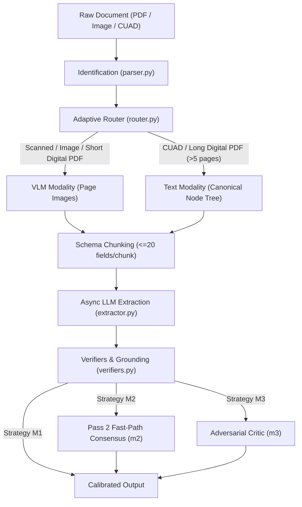

# Stage 1 Pipeline Usage & Configuration Guide

This guide covers the architecture, environment variables, configuration files, CLI scripts, and programmatic usage for the Stage 1 extraction pipeline.

---

## 1. Overview & Architecture

The pipeline processes diverse document types (CUAD legal contracts, ExtractBench digital PDFs, scanned PDFs, and forms) using layout-aware canonical path parsing (`[sec-X/p-Y/s-Z]`), adaptive modality routing (VLM vs. Text), schema chunking for dense forms, calibrated fuzzy grounding, and multi-method consensus.



---

## 2. Environment Configuration (`.env`)

Configure your LLM provider credentials in [`.env`](file:///var/home/can/Documents/sixt-hackathon-2026/Project_1/.env):

### Option A: Google Gemini Direct Endpoint (Recommended for Hackathons)

Provides dedicated rate limits, 1M+ token context window, and sub-second latency:

```bash
# In .env:
LLM_BASE_URL="https://generativelanguage.googleapis.com/v1beta/openai/"
LLM_API_KEY="AIzaSy..."          # Your Google API Key
LLM_MODEL="gemini-3.5-flash-lite" # Default extraction model
```

### Option B: SIXT LiteLLM Endpoint (Hackathon Default)

```bash
# In .env:
SIXT_LLM_KEY="sk-..."           # Handed out on site
SIXT_LLM_URL="https://llm.orange.sixt.com/v1"
SIXT_LLM_MODEL="gpt-4o-mini"
```

### Logging & Observability Settings

```bash
# Optional verbosity overrides:
LOG_LEVEL="INFO"                 # DEBUG, INFO, WARNING, ERROR
PIPELINE_LOG_FILE="pipeline.log" # Optional path to write persistent file logs
```

---

## 3. Configuration Reference (`PipelineConfig` & JSON Configs)

Configuration options are defined in `stage1_pipeline.router.PipelineConfig` and stored as JSON files in [`configs/`](file:///var/home/can/Documents/sixt-hackathon-2026/Project_1/configs/):

| Setting                    |   Type   |               Default               | Description                                                                                                                |
| :------------------------- | :-------: | :---------------------------------: | :------------------------------------------------------------------------------------------------------------------------- |
| `route_mode`             |  `str`  |             `"auto"`             | `"auto"`: dynamically routes by doc type/length; `"vlm"`: force VLM images; `"text"`: force node-tree markdown text. |
| `vlm_max_pages`          |  `int`  |                `5`                | Maximum pages for a digital PDF to be sent to VLM. Documents with more pages route to the text model.                      |
| `max_doc_chars`          |  `int`  |             `180000`             | Character threshold above which long text contracts are split along section boundaries (`[sec-X]`).                      |
| `chunk_overlap_chars`    |  `int`  |              `5000`              | Overlap character buffer between consecutive text chunks to prevent boundary clipping.                                     |
| `schema_chunk_size`      |  `int`  |               `20`               | Maximum fields per prompt. Forms with 20+ fields are split into sub-schemas and queried concurrently.                      |
| `concurrency`            |  `int`  |               `10`               | Maximum concurrent async LLM requests allowed (`asyncio.Semaphore`).                                                     |
| `model_text`             |  `str`  |     `"gemini-3.5-flash-lite"`     | Primary model used for text node-tree extraction prompts.                                                                  |
| `model_vlm`              |  `str`  |     `"gemini-3.5-flash-lite"`     | Primary model used for multimodal image extraction prompts.                                                                |
| `model_pass2`            |  `str`  |       `"gemini-3.5-flash"`       | Secondary model used for Pass 2 in Strategy M2 (Dual Consensus).                                                           |
| `pass2_strategy`         |  `str`  | `"complementary_or_second_model"` | Strategy for Pass 2 in M2: complementary modality (VLM vs Text) or distinct model.                                         |
| `boost_conf`             | `float` |              `0.97`              | Confidence assigned when Pass 1 and Pass 2 predictions agree (`values_match`).                                           |
| `penalty_mult`           | `float` |              `0.40`              | Multiplier applied to drop confidence when Pass 1 and Pass 2 disagree (`conf * 0.40`).                                   |
| `critic_model`           |  `str`  |       `"gemini-3.5-flash"`       | Model used for Adversarial Critic audits in Strategy M3.                                                                   |
| `critic_dispute_penalty` | `float` |              `0.35`              | Penalty multiplier applied when the Adversarial Critic rejects candidate evidence.                                         |
| `critic_support_boost`   | `float` |              `0.02`              | Confidence bonus applied when the Adversarial Critic confirms unambiguous evidence.                                        |
| `risk_json_mult`         | `float` |              `0.90`              | Risk multiplier applied to nested JSON fields (`x-normalizer == "json"`), which are scored all-or-nothing.               |
| `risk_corrupted_mult`    | `float` |              `0.85`              | Risk multiplier applied to documents tagged as `scanned_pdf` or `_corrupted`.                                          |

---

## 4. Predefined Strategy Configurations

### 1. `configs/m1_routed_single.json` (Fast Single-Pass)

Adaptive routing + section chunking + schema chunking + verifiers using `gemini-3.5-flash-lite`.

```json
{
  "name": "m1_routed_single",
  "route_mode": "auto",
  "vlm_max_pages": 5,
  "max_doc_chars": 180000,
  "chunk_overlap_chars": 5000,
  "schema_chunk_size": 20,
  "concurrency": 10,
  "model_text": "gemini-3.5-flash-lite",
  "model_vlm": "gemini-3.5-flash-lite",
  "risk_json_mult": 0.90,
  "risk_corrupted_mult": 0.85
}
```

### 2. `configs/m2_dual_consensus.json` (High Precision Consensus)

Pass 1 (`gemini-3.5-flash-lite`) extracts all fields; Pass 2 (`gemini-3.5-flash`) validates non-null candidates. Fields that agree are boosted to $\ge 0.97$; fields that disagree are penalized down to $\le 0.40$.

```json
{
  "name": "m2_dual_consensus",
  "route_mode": "auto",
  "vlm_max_pages": 5,
  "max_doc_chars": 180000,
  "chunk_overlap_chars": 5000,
  "schema_chunk_size": 20,
  "concurrency": 10,
  "model_text": "gemini-3.5-flash-lite",
  "model_vlm": "gemini-3.5-flash-lite",
  "model_pass2": "gemini-3.5-flash",
  "boost_conf": 0.97,
  "penalty_mult": 0.40,
  "risk_json_mult": 0.90,
  "risk_corrupted_mult": 0.85
}
```

### 3. `configs/m3_critic_verified.json` (Adversarial Critic)

Pass 1 extracts all fields; an adversarial auditor prompt checks non-null fields to verify whether evidence is unambiguously supported without guessing.

```json
{
  "name": "m3_critic_verified",
  "route_mode": "auto",
  "vlm_max_pages": 5,
  "max_doc_chars": 180000,
  "chunk_overlap_chars": 5000,
  "schema_chunk_size": 20,
  "concurrency": 10,
  "model_text": "gemini-3.5-flash-lite",
  "model_vlm": "gemini-3.5-flash-lite",
  "critic_model": "gemini-3.5-flash",
  "critic_dispute_penalty": 0.35,
  "critic_support_boost": 0.02,
  "risk_json_mult": 0.90,
  "risk_corrupted_mult": 0.85
}
```

---

## 5. CLI Execution & Benchmarking

### Running the Side-by-Side Benchmark (`benchmark.py`)

Compare multiple strategies side-by-side on the stratified mini dev set:

```bash
# Compare M1 and M2 on 5 documents:
.venv/bin/python3 benchmark.py \
    --data data/unified/dev_mini.jsonl \
    --configs configs/m1_routed_single.json configs/m2_dual_consensus.json \
    --limit 5 \
    --out-dir runs/

# Compare all 3 methods on the entire 30-document dev_mini set:
.venv/bin/python3 benchmark.py \
    --data data/unified/dev_mini.jsonl \
    --configs configs/m1_routed_single.json configs/m2_dual_consensus.json configs/m3_critic_verified.json \
    --out-dir runs/
```

#### Benchmark Output:

1. **Side-by-Side Markdown Table**: Shows Precision @0.95, Coverage @0.95, Coverage @$\ge$0.99 Precision, Hallucination Rate, Best Threshold, Net Saving %, and Total Runtime.
2. **Top False Positives Audit**: Lists the highest-confidence wrong or hallucinated values with exact document ID, field name, model prediction, and gold ground truth.

---

### Running the Extractor Directly (`stage1_pipeline/extractor.py`)

Extract predictions for any JSONL dataset:

```bash
# Online extraction using configured LLM:
.venv/bin/python3 stage1_pipeline/extractor.py \
    --data data/unified/dev_mini.jsonl \
    --out preds.jsonl \
    --concurrency 10

# Offline regex/keyword fallback (zero LLM calls):
.venv/bin/python3 stage1_pipeline/extractor.py \
    --data data/unified/dev_mini.jsonl \
    --out preds_offline.jsonl \
    --mode offline
```

---

### Scoring Output Files (`5_score.py`)

Evaluate any prediction file against ground truth using the official hackathon scoring harness:

```bash
.venv/bin/python3 5_score.py \
    --gold data/unified/dev_mini.jsonl \
    --pred runs/m2_dual_consensus_preds.jsonl \
    --threshold 0.95 \
    --error-cost 100
```

> [!IMPORTANT]
> **Business Cost Asymmetry**:
>
> - Reviewing a field by hand costs **1**.
> - Accepting a correct field automatically costs **0**.
> - Accepting a wrong or hallucinated field automatically costs **100**.
> - Emitting `value: null` with `confidence: 0.0` when unsure is the optimal action.

---

## 6. Programmatic Python Usage

```python
import json
from stage1_pipeline.parser import parse_document
from stage1_pipeline.router import PipelineConfig
from stage1_pipeline.extractor import Extractor

# 1. Load document record
record = json.loads(open("data/unified/dev_mini.jsonl").readline())

# 2. Parse into layout-aware Node Tree
parsed = parse_document(record)
print(f"Document type: {parsed.doc_type}, Page count: {parsed.page_count}")

# 3. Retrieve text with sibling node neighbors
snippet = parsed.get_node_with_neighbors("[sec-1/p-2/s-1]")

# 4. Extract with custom configuration
config = PipelineConfig(
    route_mode="auto",
    concurrency=5,
    model_text="gemini-3.5-flash-lite",
)
extractor = Extractor(config=config)
result = extractor.extract_from_parsed(record, parsed)

print(json.dumps(result, indent=2))
```

---

## 7. Observability & Logging Tags

When the pipeline runs, the custom logging engine prints color-coded, structured event banners to stdout:

- `[DOC] 📄`: Document parsed (ID, type, pages, char count).
- `[ROUTE] 🔀`: Route selection (`modality=vlm` or `text`, model name, chunks).
- `[LLM-REQ] 📤`: Outgoing request prompt character count and chunk index.
- `[LLM-RESP] 📥`: Latency in seconds, HTTP status, and exact token counts (`in`, `out`, `total`).
- `[VERIFY] 🔍`: Fuzzy grounding check, node location verification, and confidence shifts.
- `[FIN-GATE] 💰`: Arithmetic balance verification on financial fields (`subtotal + tax - discount == total`).
- `[CONSENSUS] 🤝`: Agreement (`MATCH (✅)`) or disagreement (`DIFF (❌)`) between Pass 1 and Pass 2.
- `[PROGRESS] ⏳`: Elapsed time, items/sec throughput, and ETA.
